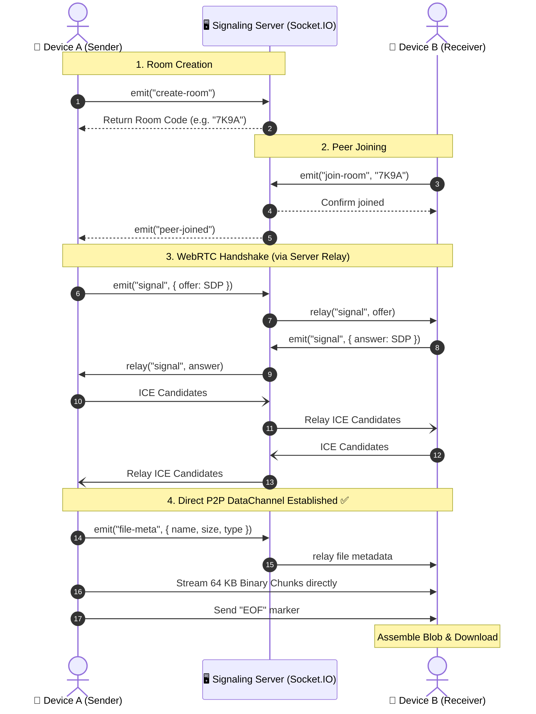

# 📡 Sendora — P2P File Transfer

Sendora is a browser-based, peer-to-peer file transfer web app built using the **MERN** stack architecture and **WebRTC DataChannels**. Files transfer directly between browsers (device-to-device) without storing data on any intermediary cloud server.

---

## 🏗️ Architecture & Signaling Flow

The signaling server (Express + Socket.IO) acts strictly as a matchmaker to exchange session descriptions (SDP) and ICE network candidates. Once the connection is established, all binary chunks flow directly over an encrypted peer-to-peer DataChannel.



---

## ⚡ Tech Stack

| Layer | Technology | Role |
| :--- | :--- | :--- |
| **Frontend** | React 18 + Vite | Lightweight, responsive single-page application |
| **Styling** | Vanilla CSS | Modern dark-themed functional UI |
| **Signaling** | Node.js + Express + Socket.IO | Relays SDP offers/answers & ICE candidates |
| **Data Transfer**| WebRTC DataChannel | Direct browser-to-browser encrypted chunk transport |
| **NAT Traversal**| Google STUN + Metered TURN | Resolves public IPs and relays when behind symmetric NATs |

---

## 🚀 Quick Start (Local Development)

### 1. Prerequisites
- Node.js (v18+ recommended)
- npm or pnpm

### 2. Start the Signaling Server
```bash
cd server
npm install
npm run dev
```
The server will run on `http://localhost:3001`.

### 3. Start the React Client
```bash
cd ../client
npm install
npm run dev
```
The client will run on `http://localhost:5173`.

### 4. How to Transfer
1. Open `http://localhost:5173` on **Device A** and click **📤 Send File**.
2. A 4-character room code will be generated (e.g. `X7K2`).
3. Open `http://localhost:5173` on **Device B**, click **📥 Receive File**, and type the 4-character code.
4. Once the devices connect peer-to-peer, select any file on Device A and click **🚀 Send**.
5. Device B receives the chunks with a real-time progress bar. Click **💾 Save File** to download.

> **LAN / Wi-Fi Usage:** To test across multiple devices on the same Wi-Fi, open `http://<YOUR_LOCAL_IP>:5173` on both devices.

---

## 🌐 Production Deployment

- **Frontend:** Hosted on [Vercel](https://vercel.com) (static build).
  - Env Var: `VITE_SIGNALING_URL=https://<your-server>.onrender.com`
  - Env Var: `VITE_TURN_USERNAME=<metered-username>`
  - Env Var: `VITE_TURN_CREDENTIAL=<metered-credential>`
- **Backend:** Hosted on [Render](https://render.com) (Web Service).
  - Env Var: `CLIENT_URL=https://<your-app>.vercel.app,http://localhost:5173`
  - Env Var: `PORT=10000`

---

## 🔮 Future Upgrades & Roadmap Ideas

Here are key improvements planned for high-scale, production-grade file sharing:

- [ ] **Direct-to-Disk Streaming (StreamSaver / FileSystem Access API):**
  - *Current State:* File chunks are buffered in browser RAM and converted into a `Blob`. Files >1.5–2 GB can exceed browser memory limits.
  - *Upgrade:* Stream incoming chunks directly into the browser's download stream using the **Origin Private File System (OPFS)** or the **File System Access API** (`showSaveFilePicker()`), enabling transfer of huge 10 GB+ 4K movies or datasets without crashing memory.
- [ ] **Multi-File & Folder Batch Sharing:**
  - Support selecting multiple files or entire folders with automatic zip compression or sequential queuing.
- [ ] **QR Code Scanning:**
  - Generate a QR code alongside the 4-letter room code so mobile devices can open and join rooms instantaneously using their camera.
- [ ] **End-to-End Encryption (E2EE) at Application Layer:**
  - While WebRTC transfers are already encrypted with DTLS/SRTP, adding client-side AES-GCM encryption with room-derived keys ensures trustless security.
- [ ] **Chunk Checksum & Transfer Resumption:**
  - Implement SHA-256 integrity validation per chunk and allow paused/interrupted transfers to resume without restarting from scratch.
- [ ] **Progressive Web App (PWA):**
  - Add offline caching, a web manifest, and Web Share Target API support to appear in the native "Share" menu on Android/iOS.
